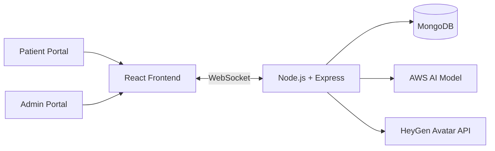

# DrAivatar – AI Medical Assistant Portal

> A production portal where patients ask medical questions and receive AI-generated answers, spoken in real time by a lifelike avatar.

🔗 **Live site:** [draivatar.com](https://draivatar.com)

> **Note:** This is a showcase repository. The source code is proprietary and was developed during my employment at Deftsoft Informatics, so it is not published here. This page describes the project and my contribution.

---

## Overview

DrAivatar gives patients a conversational way to ask medical questions. A custom AI model trained on AWS interprets each query and responds, and a HeyGen avatar speaks the answer in real time. Admins manage the platform through a separate portal.

## Key Features

- **Dual-portal system:** Patient and Admin
- **Secure authentication** with role-based access control
- **Custom AWS-trained AI model** that interprets and responds to patient queries
- **Lifelike spoken responses** using the HeyGen Avatar API
- **WebSocket communication** for low-latency streaming of avatar responses

## Tech Stack

| Layer | Technologies |
|---|---|
| Frontend | React.js |
| Backend | Node.js, Express.js, WebSocket |
| Database | MongoDB |
| AI | AWS AI Models (custom-trained), HeyGen Avatar API |
| Version Control | Git, GitHub |

## High-Level Architecture

## Screenshots

<!-- Add your screenshots to the /screenshots folder, then uncomment and edit the lines below -->
<!--

-->

## My Contribution

- Built the Patient and Admin portals with secure authentication and role-based access control
- Connected the custom AWS-trained AI model to handle patient queries
- Integrated the HeyGen Avatar API for real-time spoken responses
- Implemented WebSocket communication for low-latency avatar streaming

<!-- Edit this list so it matches exactly what YOU built. -->

## What I Learned

- Integrating third-party AI and avatar APIs into a production app
- Streaming real-time responses over WebSockets
- Building secure, role-based access for sensitive healthcare-related data

## Disclaimer

This portal is an informational assistant and not a substitute for professional medical advice.

## Contact

**Deepak Kumar** · MERN Stack Developer
[LinkedIn](https://www.linkedin.com/in/deepak-kumar-1479102b2/) · [GitHub](https://github.com/Dhaniadeepak) · meritdeepak2004@gmail.com
